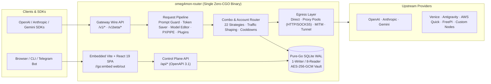

<div align="center">


# OMEG4MON Router

**Single-Binary Modular LLM Gateway & Control Plane**

*One zero-CGO Go binary. Embedded React 19 studio. Multi-protocol routing, traffic shaping, observability, and security — running at ~22 MB idle RSS.*

[](https://github.com/omeg4monx/router-gateway/releases)
[](go.mod)
[](web/package.json)
[](internal/platform/db)
[](LICENSE)

<br />

[Features](#feature-suite) · [Architecture](#architecture) · [Quick Start](#quick-start) · [Gateway API](#gateway-wire-api) · [Modules](#23-vertical-slice-modules) · [Configuration](#configuration) · [Development](#development--verification)

</div>

---

## Why OMEG4MON Router?

| Pillar | Built-in Guarantee |
| :--- | :--- |
| **Single Self-Contained Binary** | Go (`net/http` + `chi/v5`) with the compiled Vite + React 19 SPA embedded via `//go:embed`. Zero external runtime, zero Node.js server, zero CGO. |
| **Multi-Protocol Wire Compatibility** | Drop-in gateway for **OpenAI** (`/v1/chat/completions`, `/v1/responses`), **Anthropic** (`/v1/messages`, `count_tokens`), and **Gemini** (`/v1beta/models/*`) with live protocol translation. |
| **Intelligent Routing & Resilience** | **22 combo routing strategies**, account-level traffic shaping, upstream cooldowns, keyless model probes, and automatic failover across providers. |
| **Defense-in-Depth Security** | AES-256-GCM encrypted credential vault, native TLS (`--tls-cert-file` / `--tls-key-file`), Prompt Injection Guard firewall, audit trails, and automatic remote-bind hardening. |
| **Tactile Bilingual Control Plane** | Responsive React 19 + TanStack Query dashboard with **English / Bahasa Indonesia** localization, **Omegamon X-Antibody** (light) & **Omegamon Zwart** (dark) themes, and real-time SSE streams. |

---

## Architecture



- **Strict Vertical Slices:** Every domain lives in `internal/modules/<name>/` with its own SQLite migrations and OpenAPI 3.1 module spec (`contracts/openapi/modules/`), mirrored 1:1 in `web/src/features/<name>/`.
- **Decoupled Internals:** Cross-module communication flows exclusively through narrow interfaces in `internal/contracts/` and the non-blocking `internal/platform/eventbus`.
- **Split-Pool WAL Persistence:** Pure-Go `modernc.org/sqlite` running a dedicated 1-writer / 8-reader connection pool with `0600` master-key vaulting (`OMEG4MON_MASTER_KEY` or `<DATA_DIR>/master.key`).

---

## Feature Suite

### Routing & Gateway Core
- **Unified Provider Control Studio (`/dashboard/providers/`)** — Full provider registry with logos, custom OpenAI-compatible nodes, pre-save endpoint tests, keyless model probes, and full OAuth flows (**PKCE**, **Device Code**, **AWS Quick loopback**) with refresh cooldowns. Supports OpenAI, Anthropic, Gemini, Venice, Antigravity, FreePI, and custom endpoints.
- **Combos & Traffic Shaping (`/dashboard/combos/`)** — **22 routing strategies**, fallback chains, model aliases, disabled model lists, per-account strategies, and automatic upstream cooldown recovery.
- **Interactive Overview & Topology (`/dashboard/`)** — Real-time host/OS telemetry, live SSE traffic pulse, interactive `@xyflow/react` provider topology graph, and instant OpenAI/Anthropic copy-paste snippets.

### Operations & Observability
- **API Key Lifecycle (`/dashboard/keys/`)** — Scoped gateway keys, secret rotation, expiry rules, rate/quota guardrails, and per-key client snippets.
- **Usage & Cost Telemetry (`/dashboard/usage/`)** — Request logs, aggregated token/cost analytics, model pricing overrides, and live SSE streaming.
- **Live Monitor (`/dashboard/monitor/`)** — Real-time terminal-style SSE stream of incoming gateway requests with status filtering, latency inspection, and ring-buffer log capture.
- **Token Saver (`/dashboard/token-saver/`)** — Configurable context compression, prompt caching, and headroom optimization pipeline with one-click toggle.

### AI Studios & Extensions
- **Compare Models Arena (`/dashboard/arena/`)** — Multi-model side-by-side battle evaluation, streaming comparison, and persistent leaderboard.
- **Basic Chat (`/dashboard/chat/`)** — Built-in interactive prompt playground routed directly through your configured providers and combos.
- **Custom Models Editor (`/dashboard/model-editor/`)** — Per-model parameter overrides (temperature, extra JSON params) and request bypass/rewrite rules.
- **Prompt Guard (`/dashboard/prompt-guard/`)** — Configurable prompt-injection firewall rules, interactive dry-run tester, and security audit log.
- **Plugins & Skills (`/dashboard/plugins/`)** — Request-enhancement plugin interceptors, snapshot contracts, and skills catalog.
- **Telegram Bot (`/dashboard/telegram/`)** — Direct Telegram bot bridge for chatting with routed models from mobile or desktop.

### Infrastructure, Networking & Security
- **Media Gateway (`/dashboard/media/`)** — Unified routing for image, vision, audio, video, and web capabilities.
- **Protocol Translator (`/dashboard/translator/`)** — Interactive wire-protocol conversion workbench (OpenAI ↔ Anthropic ↔ Gemini) and live console stream.
- **Proxy Pools (`/dashboard/proxy-pools/`)** — Encrypted HTTP/SOCKS5 outbound proxy pools, latency probes, auto-scanner, and provider/rotate bindings.
- **Tunnel (`/dashboard/tunnel/`)** — Integrated Cloudflare / Tailscale remote exposure controls.
- **MITM Proxy (`/dashboard/mitm/`)** — Local TLS interception & CA certificate management for traffic inspection.
- **PXPIPE (`/dashboard/pxpipe/`)** — Composable request/response middleware transformation pipeline.
- **Security & Audit (`/dashboard/security/`)** — Centralized audit log, policy enforcement, and compliance tracking.
- **Notifications & Jobs (`/dashboard/notifications/`)** — Alert channels, event hooks, and background job scheduling.
- **Legacy Importer (`/dashboard/importer/`)** — Read-only SQLite inspector with dry-run and live migration from legacy router databases.

---

## Gateway Wire API

Point any standard SDK or CLI tool at `http://127.0.0.1:20128` (or your TLS host):

| Protocol | Method & Route | Purpose |
| :--- | :--- | :--- |
| **OpenAI Chat** | `POST /v1/chat/completions` | Chat completions (streaming SSE & non-streaming) |
| **OpenAI Responses** | `POST /v1/responses` · `POST /v1/responses/compact` | OpenAI Responses API & compaction |
| **Anthropic Messages** | `POST /v1/messages` · `POST /v1/messages/count_tokens` | Claude Messages API & token counting |
| **Gemini Native** | `GET /v1beta/models` · `POST /v1beta/models/{modelAction}` | Native Gemini model listing & generation |
| **Model Catalog** | `GET /v1/models` · `GET /v1/models/*` | Unified model discovery across providers & combos |

```bash
curl http://127.0.0.1:20128/v1/chat/completions \
  -H "Authorization: Bearer $OMEG4MON_API_KEY" \
  -H "Content-Type: application/json" \
  -d '{
    "model": "your-combo-or-model",
    "messages": [{ "role": "user", "content": "Hello from OMEG4MON Router" }],
    "stream": true
  }'
```

---

## Quick Start

### 1. Build & Run Single Binary

Requires **Go `1.26+`** and **Bun `1.4+`**:

```bash
# Full production cycle: fmt + lint + tests + codegen + build + smoke test + run
make prod

# Or build and run directly
make build
./bin/omeg4mon-router
```

Open **`http://127.0.0.1:20128`** to complete first-run admin initialization (`/init/`) and enter the dashboard.

### 2. Multi-Platform CLI Launcher (`@omeg4mon/router`)

```bash
npx @omeg4mon/router --host 127.0.0.1 --port 20128
```

Binary resolution order: `OMEG4MON_ROUTER_BIN` → `cli/vendor/` → `../bin/` → `../dist/` → `PATH`.

### 3. Docker (Distroless Multi-Arch)

Pull from GHCR or build locally:

```bash
docker run -d --name omeg4mon-router \
  -p 20128:20128 \
  -v omeg4mon-data:/data \
  -e OMEG4MON_HOST="0.0.0.0" \
  -e OMEG4MON_ADMIN_PASSWORD="change-me" \
  ghcr.io/omeg4monx/router-gateway:0.3.0-beta.1
```

<details>
<summary><strong>Native HTTPS / TLS Example</strong></summary>

```bash
./bin/omeg4mon-router \
  --host 0.0.0.0 \
  --port 20128 \
  --tls-cert-file /etc/certs/fullchain.pem \
  --tls-key-file /etc/certs/privkey.pem
```

</details>

> [!IMPORTANT]
> Binding to a non-loopback address (e.g., `0.0.0.0`) automatically enforces `require_login=true` and disables `/api/shutdown` unless `OMEG4MON_ALLOW_INSECURE_REMOTE=true` is explicitly set.

---

## Configuration

| Environment Variable | CLI Flag | Default | Description |
| :--- | :--- | :--- | :--- |
| `OMEG4MON_HOST` | `--host` | `127.0.0.1` | Listen host address |
| `OMEG4MON_PORT` | `--port` | `20128` | Listen port (`1–65535`) |
| `OMEG4MON_DATA_DIR` | `--data-dir` | `~/.omeg4mon-router` | SQLite database and encrypted vault directory |
| `OMEG4MON_LOG_LEVEL` | `--log-level` | `info` | Structured `slog` level (`debug`, `info`, `warn`, `error`) |
| `OMEG4MON_TLS_CERT_FILE` | `--tls-cert-file` | — | Path to TLS certificate PEM file (enables native HTTPS) |
| `OMEG4MON_TLS_KEY_FILE` | `--tls-key-file` | — | Path to TLS private key PEM file (required with cert) |
| `OMEG4MON_MASTER_KEY` | — | auto-generated | 32-byte hex AES-256-GCM vault key (`<DATA_DIR>/master.key`) |
| `OMEG4MON_ADMIN_PASSWORD` | — | — | Optional headless first-run administrator password |
| `OMEG4MON_API_TIMEOUT` | — | `30s` | Timeout for non-streaming `/api/*` control-plane requests |
| `OMEG4MON_DISABLED_MODULES` | — | — | Comma-separated list of optional modules to disable |
| `OMEG4MON_ALLOW_INSECURE_REMOTE` | — | `false` | Override non-loopback remote-bind security guard |

---

## 23 Vertical-Slice Modules

| Tier | Count | Modules |
| :--- | :---: | :--- |
| **Core** *(always enabled)* | **8** | `system`, `auth`, `settings`, `providers`, `keys`, `combos`, `gateway`, `usage` |
| **Optional** *(toggleable via `OMEG4MON_DISABLED_MODULES`)* | **15** | `arena`, `importer`, `media`, `mitm`, `modeleditor`, `notifications`, `plugins`, `promptinjection`, `proxypools`, `pxpipe`, `security`, `telegram`, `tokensaver`, `translator`, `tunnel` |

---

## Development & Verification

```bash
# Live reload (OpenAPI codegen + Go API :20128 + Vite HMR :20127 in one terminal)
make dev

# Debug single binary with embedded UI on :20128
make dev-bin

# Full quality gate (golangci-lint + Go -race + zero-CGO DB + Biome + 256 Web tests + tsc + CLI tests)
make check

# Production build & live single-binary smoke verification
make build && make smoke

# Cross-compile 6 zero-CGO release binaries (linux/darwin/windows × amd64/arm64) + SHA256SUMS.txt
make cross-build
```

Pushing any `v*` tag triggers [`.github/workflows/release.yml`](.github/workflows/release.yml), verifying web/Go/CLI gates and publishing all 6 cross-compiled binaries, `SHA256SUMS.txt`, and multi-arch (`linux/amd64`, `linux/arm64`) containers to GHCR.

---

<div align="center">

**MIT License** — Copyright © 2026 OMEG4MON. See [LICENSE](LICENSE).

</div>
